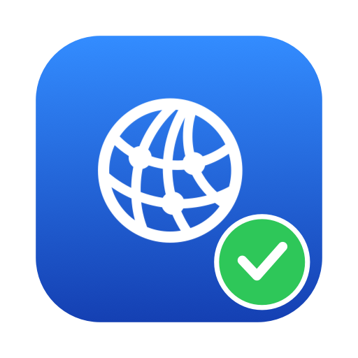

<p align="center">
  
</p>

<h1 align="center">DNS Doctor</h1>

<p align="center">
  A small macOS menu bar app that watches DNS and fixes it when it breaks.<br>
  Built for the "VPN connected, but nothing loads" problem.
</p>

<p align="center">
  <a href="https://github.com/Fahimefto/dns-doctor/releases/latest"><b>Download</b></a> ·
  <a href="#install">Install</a> ·
  <a href="#what-the-repairs-do">What the repairs do</a> ·
  <a href="#faq">FAQ</a>
</p>

## Quick install

Paste this into Terminal:

```sh
curl -fsSL https://raw.githubusercontent.com/Fahimefto/dns-doctor/master/install.sh | zsh
```

It downloads the latest release, puts **DNS Doctor** in Applications and starts it.
Look for the globe in your menu bar. Running the same command again updates to the
newest version.

Requires macOS 13 (Ventura) or newer. Works on Apple silicon and Intel Macs.

## The problem it solves

When PureVPN connects or disconnects, macOS DNS sometimes gets stuck: the internet is
still there (pings by IP work), but no website names resolve. The usual fix is

```sh
sudo dscacheutil -flushcache; sudo killall -HUP mDNSResponder
```

DNS Doctor runs that check every 30 seconds (and right after any network change),
tells you when DNS is broken, and runs the fix for you with one click.

## The menu bar icon

| Icon | Meaning |
| --- | --- |
| Globe with a green dot | DNS is working. |
| Globe with a red dot | DNS is broken: the internet is reachable by IP, but names don't resolve. Click to repair. |
| Crossed-out globe with an orange dot | Offline: neither DNS nor the internet is reachable. Check Wi-Fi or the VPN. |
| Plain globe, no dot | Checking (only for a moment after launch or a network change). |

Click the icon to open the status panel. It shows:

- Checks: three name lookups through the system resolver (apple.com, google.com,
  cloudflare.com) and a direct connection by IP that doesn't need DNS.
- DNS servers in use: each server macOS is currently configured with, and whether it
  answers when asked directly.
- A note if any network service has DNS servers typed in manually.
- Repair DNS, and under "More fixes", public DNS and a diagnostics copy button.

When DNS breaks, the app also posts a notification (turn this off with "Notify when
DNS breaks" at the bottom of the panel).

## Install

### Option 1: one command (recommended)

```sh
curl -fsSL https://raw.githubusercontent.com/Fahimefto/dns-doctor/master/install.sh | zsh
```

The script ([install.sh](install.sh)) downloads `DNS-Doctor.dmg` from the latest
release, closes any running copy, copies the app into `/Applications` (asking for
your password only if that folder isn't writable), and opens it. Because it's not a
browser download, macOS doesn't show the "could not verify" warning.

### Option 2: download the DMG

1. Download `DNS-Doctor.dmg` from the latest release:
   <https://github.com/Fahimefto/dns-doctor/releases/latest>
2. Open the DMG and drag **DNS Doctor** to **Applications**.
3. Open it from Applications. It appears in the menu bar only; there is no Dock icon.

The first time, macOS says *"Apple could not verify 'DNS Doctor' is free of
malware"*. That's because the app isn't notarized with a paid Apple Developer account,
not because anything is wrong with it. To allow it (once per Mac):

- Click **Done** on the warning, go to **System Settings → Privacy & Security**,
  scroll down to the message about DNS Doctor, click **Open Anyway** and enter your
  password. Or
- Run this in Terminal, then open the app normally:

  ```sh
  xattr -dr com.apple.quarantine "/Applications/DNS Doctor.app"
  ```

### After installing

- Tick **Open at login** in the panel so it starts with your Mac.
- Allow notifications when asked, so you get an alert the moment DNS breaks.

### Uninstall

Quit it from the panel (**Quit**), then delete `/Applications/DNS Doctor.app`. If you
turned on public DNS, click **Restore automatic DNS** before uninstalling.

## Using it

1. Leave it running. The globe in the menu bar shows a **green dot** while things are fine.
2. When the dot turns **red** (and you get a notification), click the globe.
3. Click **Repair DNS** and enter your Mac password (or use Touch ID).
4. The panel tells you what fixed it. Usually that's the first step and takes a couple
   of seconds.
5. If it says it's still broken, open **More fixes** and click **Use public DNS**, or
   disconnect and reconnect the VPN. Click **Restore automatic DNS** later to go back.
6. Need help from someone? **More fixes → Copy diagnostics** and paste it to them.

## What the repairs do

Every fix asks for your macOS password through the standard admin prompt. Nothing is
installed, nothing runs in the background as root, and every change can be undone.

### Repair DNS

Clicking **Repair DNS** escalates in two levels and stops as soon as DNS works again.

**Level 1: flush.** The same commands as the manual fix:

```sh
/usr/bin/dscacheutil -flushcache
/usr/bin/killall -HUP mDNSResponder
```

The app waits about 1.5 seconds and re-checks. This fixes the common case where
macOS's DNS service is stuck.

**Level 2: deeper fix.** Only runs if level 1 didn't help. It:

1. Fully restarts the DNS service: `killall mDNSResponder mDNSResponderHelper`
   (macOS relaunches it immediately).
2. For any network service whose manually-set DNS servers all fail to answer
   (typically servers a VPN left behind): `networksetup -setdnsservers "<service>" empty`,
   which puts the service back to automatic DNS from the router.
3. For each active DHCP interface: `ipconfig set <device> DHCP`, which renews the lease
   so the router hands out fresh DNS servers. The network drops for a second or two.
4. Flushes again (the level 1 commands).

Then it polls every 2 seconds for up to 15 seconds and reports which step fixed it. If
nothing worked, it suggests public DNS or reconnecting the VPN.

### More fixes → Use public DNS (Cloudflare + Google)

Sets DNS on every enabled network service to `1.1.1.1 1.0.0.1 8.8.8.8 8.8.4.4`:

```sh
/usr/sbin/networksetup -setdnsservers "<service>" 1.1.1.1 1.0.0.1 8.8.8.8 8.8.4.4
```

Before doing that, it saves what each service had. While public DNS is on, the button
changes to **Restore automatic DNS**, which puts those saved settings back exactly
(`empty` for services that were automatic).

### More fixes → Copy diagnostics

Copies a plain-text report (app and macOS version, status, each check, each DNS server
and whether it answers, manual DNS per service, public DNS mode, last checked time) to
the clipboard, ready to paste into a chat or ticket.

## Command line check

The same probes are available from Terminal, with no UI and no notifications:

```sh
"/Applications/DNS Doctor.app/Contents/MacOS/DNSDoctor" --check
```

It prints the diagnostics report and exits with:

| Code | Meaning |
| --- | --- |
| 0 | DNS is working |
| 1 | DNS is broken (internet reachable by IP, names don't resolve) |
| 2 | Offline (nothing reachable) |

Useful in scripts, for example `... --check || echo "DNS is down"`.

## FAQ

**Why does it ask for my password?** Flushing the DNS cache and changing DNS settings
need admin rights on macOS, exactly like `sudo` in the manual fix. The app uses the
standard macOS admin prompt; it never sees or stores your password.

**Does it change anything on its own?** No. It only checks. Nothing changes until you
click a button.

**Does it send my data anywhere?** No. Its only network traffic is the checks: name
lookups for apple.com, google.com and cloudflare.com, a connection to 1.1.1.1, 8.8.8.8
and 9.9.9.9 by IP, and direct lookups against your own DNS servers.

**It says "No internet connection" but I'm online.** That status means even the
IP-only connection failed, which usually means Wi-Fi dropped or the VPN is still
connecting. Click the refresh button after a few seconds.

**Repair says it's still broken.** The VPN's own DNS servers are probably down. Use
**More fixes → Use public DNS**, or reconnect the VPN. Some company sites only resolve
through the VPN's DNS, so switch back with **Restore automatic DNS** once things work.

**Does it work with VPNs other than PureVPN?** Yes. It checks DNS in general, so it
helps with any VPN or network that leaves macOS DNS in a bad state.

## Build from source

Requirements: macOS 13 or later and the Command Line Tools
(`xcode-select --install`). Xcode is not needed.

```sh
scripts/build.sh 1.0.0
```

This compiles a universal binary (Apple silicon + Intel), builds the app icon, signs
the app ad-hoc, and writes both `dist/DNS Doctor.app` and
`dist/DNS-Doctor-1.0.0.dmg`. Pass a different version number as the first argument to
change what the app reports.

For a quick debug run without the bundle, `swift run` works too, but notifications
and "Open at login" need the real .app bundle.

## Project layout

```
Sources/DNSDoctor/
  main.swift             Menu bar item, popover, status icon, --check entry point
  DNSMonitor.swift       Periodic checks, health state, repair flow, notifications
  Probes.swift           System resolver lookups, reach-by-IP, direct server queries (dig)
  NetworkServices.swift  Reads per-service DNS settings via networksetup
  DNSRepair.swift        The privileged fixes (flush, deep fix, public DNS, restore)
  StatusView.swift       The popover UI (SwiftUI)
Resources/Info.plist     Bundle metadata (menu bar only app)
scripts/build.sh         Universal build, icon, signing, DMG
scripts/make_icon.swift  Draws the app icon
```
